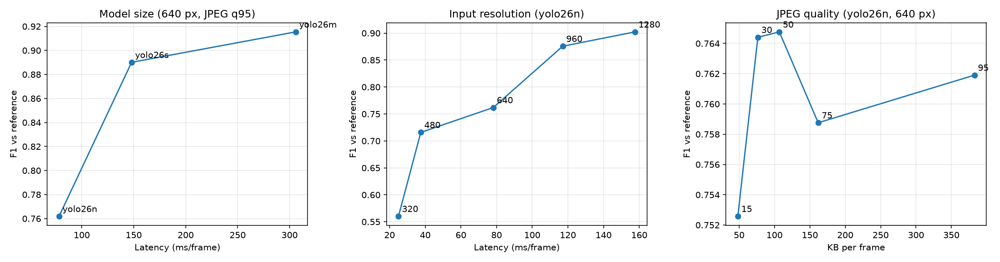
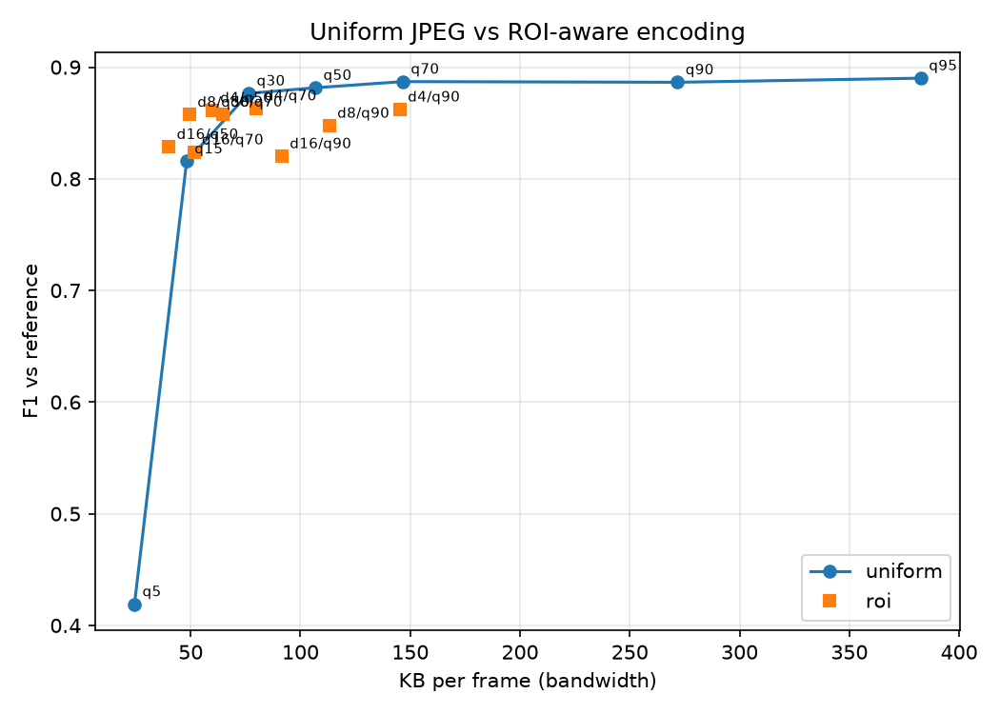

# Edge Vehicle Analytics

> Initial version based on [khayyam90/yolo-vehicules-detection](https://github.com/khayyam90/yolo-vehicules-detection) (MIT). Extended with sub-type classification, a latency/accuracy/bandwidth benchmark and an ROI-aware encoding experiment.

Vehicle detection, tracking and line-crossing counting on traffic video (YOLO26 + ByteTrack + OpenCV), plus a small study of how model size, input resolution, JPEG compression and region-of-interest (ROI) encoding trade accuracy against latency and bandwidth. The motivation is edge video analytics, where compute and network bandwidth are limited.

## Pipeline

## Repository layout

| Path | Purpose |
|---|---|
| `detect_cars.py` | Detection, tracking, counting and optional sub-types |
| `vehicle_types.py` | Second-stage sub-type classifier with per-track voting |
| `experiments/common.py` | Frame loading, JPEG round trip, IoU matching, F1 scoring |
| `experiments/benchmark.py` | Model size / resolution / JPEG quality sweeps |
| `experiments/roi_experiment.py` | Uniform JPEG vs ROI-aware encoding |
| `experiments/crop_sheets.py` | Contact sheets of classified crops, for manual checking |
| `results/` | CSVs, plots and crop sheets produced by the runs |

## Setup (Linux / WSL)

```bash
python3 -m venv .venv && source .venv/bin/activate
pip install --upgrade pip
pip install torch torchvision --index-url https://download.pytorch.org/whl/cpu   # CPU-only build; use the default index for a GPU build
pip install -r requirements.txt matplotlib yt-dlp
```

Put your video at `traffic.mp4` in the repo root. If it is missing, `detect_cars.py` tries to download the video configured in the script (yt-dlp may need a JavaScript runtime such as Node.js for YouTube). The video is not stored in this repository.

## Usage

```bash
# counting with sub-types (headless); DUMP_CROPS=1 also saves sample crops
DUMP_CROPS=1 python detect_cars.py --subtypes --no-display --no-save --imgsz 640
python experiments/crop_sheets.py

# experiments (40 evenly sampled frames)
python experiments/benchmark.py --frames 40
python experiments/roi_experiment.py --frames 40
```

## Results

All results come from a single traffic video (1920x1080, 30 fps, 9184 frames), run on CPU only (no GPU) under WSL2.

### 1. Counting (full video, `yolo26n` at 640 px, conf 0.2, ByteTrack)

A vehicle is counted once when the centre of its tracked box crosses a horizontal line at half the frame height. Total crossings: **358**.

| Class | Down | Up | Total |
|---|---|---|---|
| car | 315 | 3 | 318 |
| truck | 23 | 0 | 23 |
| bus | 17 | 0 | 17 |

Sub-type labels (second-stage ImageNet classifier). These are experimental and have **not** been validated against manual labels:

| Label | Count |
|---|---|
| car (van) | 291 |
| truck (van) | 17 |
| car (sports car) | 15 |
| bus (van) | 11 |
| truck (minibus) | 3 |
| bus (bus) | 2 |
| bus (minibus) | 2 |
| car (minibus) | 2 |
| truck (garbage truck) | 2 |
| bus (garbage truck) | 1 |

### 2. Latency / accuracy benchmark (40 frames)

F1 is measured against a reference run (`yolo26l` at 1280 px on clean frames), not against human labels. Count MAE is the mean absolute error of the per-frame vehicle count against the same reference.



| Model (640 px, JPEG q95) | Latency (ms/frame) | F1 | Count MAE |
|---|---|---|---|
| yolo26n | 78 | 0.762 | 3.30 |
| yolo26s | 148 | 0.890 | 1.40 |
| yolo26m | 306 | 0.915 | 1.25 |

| Input size (yolo26n) | Latency (ms/frame) | F1 | Count MAE |
|---|---|---|---|
| 320 | 25 | 0.560 | 7.17 |
| 480 | 38 | 0.716 | 5.10 |
| 640 | 78 | 0.762 | 3.30 |
| 960 | 117 | 0.876 | 1.80 |
| 1280 | 158 | 0.902 | 1.12 |

| JPEG quality (yolo26n, 640 px) | KB/frame | F1 |
|---|---|---|
| 95 | 383 | 0.762 |
| 75 | 162 | 0.759 |
| 50 | 107 | 0.765 |
| 30 | 76 | 0.764 |
| 15 | 48 | 0.753 |

Findings:

- Input resolution and model size matter most. `yolo26n` at 1280 px reaches an F1 of about 0.90 at roughly 158 ms per frame, similar to `yolo26s` at 640 px (about 0.89 at 148 ms) on this CPU.
- JPEG compression barely affects detection until it becomes extreme: F1 for `yolo26n` stays around 0.76 from quality 95 down to 30 while the frame size drops from about 380 KB to about 75 KB.

### 3. ROI-aware encoding vs uniform JPEG (40 frames)

A cheap edge model (`yolo26n`, 640 px, conf 0.15) proposes vehicle boxes. The background is downscaled by a factor `d` and upsampled, blended with the sharp vehicle regions through a feathered mask, and the result is encoded as one JPEG at quality `q`. A larger model (`yolo26s`, 640 px) then detects on the decoded frame.



| Method | Setting | KB/frame | Precision | Recall | F1 |
|---|---|---|---|---|---|
| uniform | q95 | 382.6 | 0.919 | 0.863 | 0.890 |
| uniform | q90 | 271.7 | 0.915 | 0.860 | 0.886 |
| uniform | q70 | 146.7 | 0.918 | 0.858 | 0.887 |
| uniform | q50 | 106.8 | 0.913 | 0.853 | 0.882 |
| uniform | q30 | 76.5 | 0.918 | 0.838 | 0.877 |
| uniform | q15 | 48.2 | 0.882 | 0.758 | 0.816 |
| uniform | q5 | 24.4 | 0.518 | 0.352 | 0.419 |
| roi | d4/q90 | 145.3 | 0.951 | 0.789 | 0.862 |
| roi | d4/q70 | 80.0 | 0.951 | 0.790 | 0.863 |
| roi | d4/q50 | 59.8 | 0.949 | 0.789 | 0.861 |
| roi | d8/q90 | 113.2 | 0.949 | 0.766 | 0.848 |
| roi | d8/q70 | 64.5 | 0.958 | 0.776 | 0.858 |
| roi | d8/q50 | 49.5 | 0.960 | 0.774 | 0.857 |
| roi | d16/q90 | 91.5 | 0.957 | 0.718 | 0.820 |
| roi | d16/q70 | 51.5 | 0.951 | 0.726 | 0.824 |
| roi | d16/q50 | 40.0 | 0.958 | 0.730 | 0.829 |

Findings:

- ROI-aware encoding is competitive only at the lowest bitrates. At about 40-50 KB per frame it reaches an F1 of about 0.82-0.83, versus 0.82 for uniform JPEG at a similar size, and it has no operating point below about 40 KB.
- At higher bitrates plain uniform JPEG is as good or better, and ROI encoding lowers recall.
- The differences at the low end are small and come from 40 frames, so treat this as a preliminary result.

## Method notes and limitations

- **Pseudo ground truth.** Benchmark and ROI accuracy is agreement with a large reference model, not human-labelled accuracy. Counts have not yet been checked against a manual count.
- **Small sample.** 40 evenly sampled frames (downscaled to at most 1280 px wide) from one video; detections matched at IoU 0.5 with class awareness.
- **Latency.** CPU only, single run, model inference time only (JPEG encoding excluded). Expect noise; small differences are not meaningful.
- **ROI method.** It is a pre-filtering approximation (blur plus one JPEG), not codec-level ROI or tile encoding. ROIs come from the same frame being encoded, which is optimistic compared with using earlier frames.
- **Sub-types.** The classifier is trained on ImageNet, which has no auto-rickshaw or e-rickshaw class, and car sub-types are likely unreliable. Only the COCO-level counts should be treated as the headline result.
- **Tracking.** ID switches can cause double or missed counts; tracking quality has not been measured.

## Future work

Planned next, towards a configurable framework for evaluating vision analytics pipelines:

- [ ] Hand-count a short clip and report count error against a real ground truth.
- [ ] Add frame-rate sampling and a bandwidth/latency model (end-to-end latency at 1, 5 and 20 Mbps) to the parameter sweeps.
- [ ] Refactor into a modular pipeline (source, sampler, encoder, network, detector, tracker) with YAML configs, a sweep runner and Pareto plots.
- [ ] Add a tile-based variant (send only tiles that overlap vehicles) and compare it with uniform and blur-ROI encoding.
- [ ] Repeat the sweeps on additional videos and conditions (other cameras, night, rain).

Further ideas:

- [ ] Selective super-resolution for small or low-confidence detections.
- [ ] Benchmark on real edge hardware (Raspberry Pi, Jetson) with ONNX / TensorRT / INT8 exports.
- [ ] Codec-level ROI or tile encoding instead of the blur-and-JPEG approximation.
- [ ] Privacy-preserving analytics (blur plates and faces, keep only anonymised trajectories).
- [ ] Fine-tune on Indian vehicle data (e.g. IDD) to separate auto-rickshaws, e-rickshaws, scooters and other types.
- [ ] Tracking metrics (HOTA, IDF1), speed estimation, traffic forecasting and a dashboard.

## License

MIT. The original copyright notice is kept in `LICENSE`.
